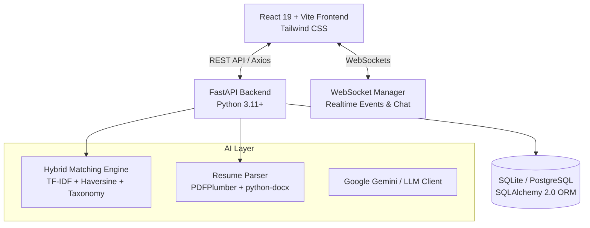

# 🌐 JOB HUB — AI-Powered Smart Placement & Semantic Matching Platform

<p align="center">
  <a href="https://saif-alsaad.github.io/JobHub/">
    
  </a>
  
  
  
  
  
  
  
</p>

> [!NOTE]
> **🚀 Live Web Preview**: Access the interactive static frontend at [https://saif-alsaad.github.io/JobHub/](https://saif-alsaad.github.io/JobHub/).
>
> *(To activate GitHub Pages on your repository: open **Settings** > **Pages** > **Build and deployment > Source**, select **"GitHub Actions"**).*

---

## 📖 Table of Contents
- [✨ Overview](#-overview)
- [👥 Team Collaboration & Quick Commands for Each Member](#-team-collaboration--quick-commands-for-each-member)
- [🚀 Quick Start (How to Run the Project)](#-quick-start-how-to-run-the-project)
  - [Method 1: One-Click Launcher (Windows)](#method-1-one-click-launcher-windows-easiest)
  - [Method 2: Step-by-Step Manual Run](#method-2-step-by-step-manual-run)
  - [Method 3: Docker Compose](#method-3-docker-compose)
- [🔑 Demo Login Accounts](#-demo-login-accounts)
- [📁 Project Structure](#-project-structure)
- [🌟 Key Features](#-key-features)
  - [1. 🧠 AI-Powered Hybrid Semantic Matching](#1--ai-powered-hybrid-semantic-matching)
  - [2. 📄 AI Resume Parser & Skill Extractor](#2--ai-resume-parser--skill-extractor)
  - [3. 👤 Job Seeker Experience](#3--job-seeker-experience)
  - [4. 🏢 Recruiter & Hiring Pipeline](#4--recruiter--hiring-pipeline)
  - [5. 🛡️ System Administration & Governance](#5-️-system-administration--governance)
  - [6. 💬 Real-Time Chat & Instant Notification Hub](#6--real-time-chat--instant-notification-hub)
- [🛠️ Tech Stack & Architecture](#-tech-stack--architecture)
- [🔌 API Endpoints & Documentation](#-api-endpoints--documentation)
- [⚙️ Configuration & Environment Variables](#-configuration--environment-variables)
- [🌱 Database Reseeding](#-database-reseeding)

---

## ✨ Overview

**JOB HUB** is an enterprise-grade placement and talent discovery ecosystem designed to bridge job seekers, tech recruiters, and administrators. Powered by a **hybrid AI matching algorithm** (combining TF-IDF semantic vector similarity, weighted skill taxonomy graphs, experience scoring, and geospatial proximity calculations), JobHub delivers instant, transparent match scores and actionable gap analyses.

---

## 👥 Team Collaboration & Quick Commands for Each Member

To keep development organized and track contributions cleanly, each team member has an isolated sub-branch created from `main`:

| Member | Contribution Branch | GitHub Remote Link |
| :--- | :--- | :--- |
| **Saif** | [`Saif`](https://github.com/Saif-AlSaad/JobHub/tree/Saif) | [View Saif's Branch](https://github.com/Saif-AlSaad/JobHub/tree/Saif) |
| **Nadim** | [`Nadim`](https://github.com/Saif-AlSaad/JobHub/tree/Nadim) | [View Nadim's Branch](https://github.com/Saif-AlSaad/JobHub/tree/Nadim) |
| **Rizvi** | [`Rizvi`](https://github.com/Saif-AlSaad/JobHub/tree/Rizvi) | [View Rizvi's Branch](https://github.com/Saif-AlSaad/JobHub/tree/Rizvi) |

### ⚡ Quick Commands for Each Member

#### 1. Saif
```bash
# Switch to your branch
git checkout Saif

# Work on your changes, then stage and commit
git add .
git commit -m "feat: description of work done"

# Push to your remote branch
git push origin Saif
```

#### 2. Nadim
```bash
# First time setup on your computer
git fetch origin
git checkout Nadim

# Work on your changes, then stage and commit
git add .
git commit -m "feat: description of work done"

# Push to your remote branch
git push origin Nadim
```

#### 3. Rizvi
```bash
# First time setup on your computer
git fetch origin
git checkout Rizvi

# Work on your changes, then stage and commit
git add .
git commit -m "feat: description of work done"

# Push to your remote branch
git push origin Rizvi
```

#### 🔄 Keeping Your Branch Updated with `main`
Before starting new tasks or creating a pull request, sync your branch with `main`:
```bash
git checkout <your-branch-name>
git fetch origin
git merge origin/main
git push
```

#### 🚀 Merging into Main (Pull Requests)
When a feature is finished and ready to merge into production:
1. Push your branch commits: `git push origin <your-branch-name>`.
2. Go to GitHub: **[Create Pull Request](https://github.com/Saif-AlSaad/JobHub/pulls)**.
3. Set **base: `main`** ➔ **compare: `<your-branch-name>`**.
4. Review your diff and click **"Create pull request"**.

---

## 🚀 Quick Start (How to Run the Project)

### Prerequisites
Make sure you have installed:
- **Python**: `v3.11` or higher
- **Node.js**: `v18.0` or higher & `npm`

---

### Method 1: One-Click Launcher (Windows — Easiest)

Simply double-click [`start-all.bat`](file:///e:/VSCode/JobHuBB/start-all.bat) or run from your terminal:

```cmd
.\start-all.bat
```

> [!TIP]
> This automatically starts the **FastAPI backend** (Port 8000) and the **Vite React frontend** (Port 5173) in two dedicated terminal windows.

---

### Method 2: Step-by-Step Manual Run

#### 1️⃣ Start the Backend
Open a terminal in the project root:
```powershell
# Navigate into backend directory
cd backend

# Create virtual environment (if not already created)
python -m venv venv

# Activate virtual environment
.\venv\Scripts\activate

# Install dependencies (first time only)
pip install -r requirements.txt

# Run the FastAPI server
python -m uvicorn app.main:app --reload --port 8000
```
- **Backend API**: [http://localhost:8000](http://localhost:8000)
- **Interactive Swagger Docs**: [http://localhost:8000/docs](http://localhost:8000/docs)

#### 2️⃣ Start the Frontend
Open a second terminal window:
```powershell
# Navigate into frontend directory
cd frontend

# Install dependencies (first time only)
npm install

# Launch Vite development server
npm run dev
```
- **Web Application**: [http://localhost:5173](http://localhost:5173)

---

### Method 3: Docker Compose
If you have **Docker Desktop** installed, run the full containerized stack (PostgreSQL + pgvector, Backend, Frontend):

```bash
docker-compose up --build
```

---

## 🔑 Demo Login Accounts

The database comes pre-seeded with rich test data, real-world Bangladesh tech companies (TechNova, Brain Station 23, Chaldal, Pathao, etc.), candidate profiles, and application records:

| Role | Email | Password | Access / Portal |
| :--- | :--- | :--- | :--- |
| 🧑‍💻 **Job Seeker** | `sarah.rahman@jobhub.io` | `password123` | Seeker Dashboard, AI Job Matches, Applications Tracker, Resume Parser |
| 💼 **Recruiter** | `recruiter@technova.io` | `password123` | Recruiter Dashboard, Candidate Pipeline, Post Job Studio, Applicant Scoring |
| 🛡️ **Administrator** | `admin@jobhub.io` | `password123` | Admin Portal, User Management, Recruiter Approvals, Platform Analytics |

---

## 📁 Project Structure

```
JobHuBB/
├── 📄 README.md                    # Project documentation & onboarding guide
├── 📄 docker-compose.yml           # Full-stack containerization (Postgres + Backend + Frontend)
├── 📄 .env.example                 # Environment variables blueprint
├── ⚙️ start-all.bat                # Windows 1-click launcher for Backend & Frontend
├── ⚙️ run-backend.bat              # Standalone Windows launcher for FastAPI server
├── ⚙️ run-frontend.bat             # Standalone Windows launcher for React client
│
├── 📂 backend/                     # High-performance FastAPI backend service
│   ├── 📄 requirements.txt         # Python dependencies
│   ├── 📄 seed_data.py             # Realistic database seeder (32 jobs, 20 candidates, chats)
│   ├── 📄 job_hub.db               # Pre-initialized SQLite database (Zero-config local mode)
│   ├── 📂 uploads/                 # Storage for uploaded PDF/DOCX resumes & attachments
│   └── 📂 app/                     # Core application source
│       ├── 📄 main.py              # FastAPI app initialization, middleware, WebSocket route
│       ├── 📄 config.py            # Pydantic BaseSettings environment config & weight tuning
│       ├── 📄 database.py          # SQLAlchemy 2.0 engine, SessionLocal, and DeclarativeBase
│       │
│       ├── 📂 ai/                  # AI, NLP & Parsing Engines
│       │   ├── 📄 resume_parser.py # PDF/DOCX text extraction & skill taxonomy matching
│       │   ├── 📄 job_parser.py    # JD requirement extraction & structuring
│       │   └── 📄 llm_client.py    # Google Gemini API connector with deterministic fallbacks
│       │
│       ├── 📂 api/                 # RESTful API route controllers
│       │   ├── 📄 auth.py          # Login, Register, Profile info, JWT token generation
│       │   ├── 📄 jobs.py          # Jobs CRUD, semantic search, AI match breakdown
│       │   ├── 📄 seekers.py       # Candidate profiles, preferences, match recommendations
│       │   ├── 📄 applications.py  # Application submissions, status pipeline transitions
│       │   ├── 📄 recruiters.py    # Recruiter company profiles & job candidate rankings
│       │   ├── 📄 resume.py        # Resume upload, parsing & AI skill population
│       │   ├── 📄 chat.py          # Direct messaging conversations & history
│       │   ├── 📄 notifications.py # Notification inbox & preferences
│       │   └── 📄 admin.py         # Recruiter approvals, user metrics, system stats
│       │
│       ├── 📂 models/              # SQLAlchemy ORM models
│       │   └── 📄 models.py        # Users, Companies, Jobs, Applications, Matches, Messages
│       ├── 📂 schemas/             # Pydantic validation & response schemas
│       │   └── 📄 schemas.py       # Strict schema definitions for requests/responses
│       ├── 📂 services/            # Domain business logic
│       │   ├── 📄 matching_service.py     # 4-factor Hybrid AI match scoring algorithm
│       │   ├── 📄 location_service.py     # Haversine distance & travel fit scoring
│       │   └── 📄 notification_service.py # Automated event alerts dispatcher
│       └── 📂 websocket/           # Realtime bidirectional communications
│           └── 📄 connection_manager.py   # Multi-user active WebSocket channel manager
│
├── 📂 frontend/                    # Modern React 19 Single Page Application (SPA)
│   ├── 📄 package.json             # NPM dependencies & build scripts
│   ├── 📄 vite.config.js           # Vite build and plugin configurations
│   ├── 📄 tailwind.config.js       # Design tokens, color system, custom typography
│   ├── 📄 index.html               # Entry HTML shell with Plus Jakarta Sans fonts
│   └── 📂 src/
│       ├── 📄 App.jsx              # Application router, role-based access controllers
│       ├── 📄 main.jsx             # React DOM root entry
│       ├── 📄 index.css            # Base Tailwind imports & CSS custom properties
│       │
│       ├── 📂 context/             # Global React State Providers
│       │   ├── 📄 AuthContext.jsx         # User session, JWT persistence & auth methods
│       │   └── 📄 NotificationContext.jsx # Live WebSocket alerts & badge state
│       │
│       ├── 📂 services/            # Client HTTP & WebSocket adapters
│       │   └── 📄 api.js           # Axios instance with auto-injected JWT Bearer tokens
│       │
│       ├── 📂 components/          # Reusable UI components
│       │   ├── 📄 Navbar.jsx              # Navigation with responsive menu & live notification bell
│       │   ├── 📄 Sidebar.jsx             # Role-specific vertical sidebar navigation
│       │   ├── 📄 JobCard.jsx             # Premium job card with instant AI match pill
│       │   ├── 📄 SkillMatchBreakdown.jsx # Visual badges for matched, transferable & missing skills
│       │   ├── 📄 ResumeReviewModal.jsx   # Modal for reviewing candidate resume & parsed data
│       │   ├── 📄 SkeletonLoader.jsx      # Shimmer placeholder for loading states
│       │   └── 📄 EmptyState.jsx          # Clean zero-data illustrations
│       │
│       └── 📂 pages/               # Application view screens
│           ├── 📄 LoginPage.jsx               # Quick 1-click role switcher demo login
│           ├── 📄 RegisterPage.jsx            # Account creation for Seekers & Recruiters
│           ├── 📄 JobSeekerDashboard.jsx      # Recommended jobs, stats, quick match view
│           ├── 📄 RecruiterDashboard.jsx      # Job postings, candidate ranking by AI match
│           ├── 📄 AdminDashboard.jsx          # Approvals, user management, platform insights
│           ├── 📄 JobsSearchPage.jsx          # Advanced search with score & radius filters
│           ├── 📄 JobDetailsPage.jsx          # Detailed JD, full skill gap analysis, apply modal
│           ├── 📄 ApplicationsTrackerPage.jsx # Application status pipeline tracker
│           ├── 📄 ProfilePage.jsx             # Profile manager & instant resume parser
│           ├── 📄 PostJobPage.jsx             # Recruiter job creation studio
│           ├── 📄 MessagesPage.jsx            # Real-time chat interface with recruiter/seeker
│           └── 📄 NotificationsPage.jsx       # Alert center with filterable categories
│
└── 📂 database/                    # SQL schema definitions & database scripts
    └── 📂 seed/
        └── 📄 schema.sql           # Canonical PostgreSQL / pgvector schema definition
```

---

## 🌟 Key Features

### 1. 🧠 AI-Powered Hybrid Semantic Matching
JobHub does not rely on simple keyword search. It calculates an explainable **Hybrid Match Score (0–100%)** combining:
- **Semantic Text Similarity (40%)**: Uses Scikit-Learn TF-IDF vectorization and cosine similarity between the applicant’s experience, projects, and headline vs. the job description.
- **Skill Overlap (30%)**: Matches the candidate’s skills against required skills (75% weight) and preferred skills (25% weight).
- **Experience & Education Fit (15%)**: Evaluates degree level and years of practical experience.
- **Geographic Proximity (15%)**: Haversine distance calculation between the candidate's coordinates and company office, factoring in remote work options.

### 2. 📄 AI Resume Parser & Skill Extractor
- Upload your resume in **PDF** or **DOCX** format.
- Extracts education, experience, contact details, and automatically identifies skills using an extensive **technology taxonomy** (languages, frameworks, databases, cloud, DevOps, and AI/ML).
- Normalizes variations (e.g. `react.js` ➔ `React`, `golang` ➔ `Go`, `fast api` ➔ `FastAPI`).

### 3. 👤 Job Seeker Experience
- **AI Recommendation Feed**: Discover top opportunities ranked by personal match percentage.
- **Detailed Skill Gap Breakdown**: Every job displays:
  - 🟢 **Matched Skills**: What you already have.
  - 🔵 **Transferable Skills**: Related tools and concepts.
  - 🟡 **Missing Skills**: Clear recommendations on what to learn to qualify.
- **1-Click Application**: Apply with your parsed profile and optional custom cover note.
- **Interactive Application Tracker**: Monitor application states (*Submitted* ➔ *Under Review* ➔ *Interview Scheduled* ➔ *Offer* / *Rejected*).

### 4. 🏢 Recruiter & Hiring Pipeline
- **Job Creation Studio**: Post open roles with required & preferred skill tags, remote work status, salary bands, and coordinates.
- **Candidate AI Ranking**: View all applicants ranked by their hybrid match score.
- **Quick Resume Review**: Inspect candidate credentials, contact details, and matched skills inline.
- **Pipeline Stage Management**: Update candidate status with one click, triggering automated notifications to the seeker.

### 5. 🛡️ System Administration & Governance
- **Recruiter Approvals**: Protect platform integrity by approving or rejecting newly registered recruiter accounts.
- **Platform Analytics**: Track total active jobs, registered seekers, companies, and application velocity.
- **User Management**: Activate, deactivate, or audit user accounts across the system.

### 6. 💬 Real-Time Chat & Instant Notification Hub
- **WebSocket Live Messaging**: Low-latency direct messaging between recruiters and candidates tied to specific job applications.
- **Instant Alerts**: Receive real-time push notifications for interview requests, application status updates, and high-match job opportunities.

---

## 🛠️ Tech Stack & Architecture



| Layer | Technologies |
| :--- | :--- |
| **Frontend** | React 19, Vite, Tailwind CSS, Lucide Icons, React Router v7, Axios |
| **Backend** | FastAPI, Python 3.11/3.14, Uvicorn, Pydantic v2, Scikit-Learn |
| **Database** | SQLite (Default Zero-Config) / PostgreSQL (Docker pgvector ready), SQLAlchemy 2.0 |
| **Security** | JWT (JSON Web Tokens), Passlib (Bcrypt hashing), Role-Based Access Control |
| **File Processing** | PDFPlumber, python-docx, Python-Multipart |
| **Realtime** | Native WebSockets with heartbeat keepalive |

---

## 🔌 API Endpoints & Documentation

Once the backend is running, open **[http://localhost:8000/docs](http://localhost:8000/docs)** to access the interactive Swagger UI.

### Major API Endpoints Overview:
- `POST /api/v1/auth/login` — Authenticate and receive JWT access token
- `POST /api/v1/auth/register` — Create new seeker or recruiter account
- `GET  /api/v1/auth/me` — Retrieve current authenticated user profile
- `GET  /api/v1/jobs` — Query jobs with keyword, location radius, and score filters
- `GET  /api/v1/jobs/{id}/match-score` — Compute candidate-specific AI match breakdown
- `POST /api/v1/resume/upload` — Parse resume document and return extracted profile data
- `GET  /api/v1/applications` — List applications for candidate or recruiter
- `PATCH /api/v1/applications/{id}/status` — Advance candidate through recruitment pipeline
- `GET  /api/v1/chat/conversations` — Fetch chat threads
- `WS   /ws/{user_id}` — WebSocket connection for live messages and notifications

---

## ⚙️ Configuration & Environment Variables

Environment variables can be customized in `.env` (or `backend/.env`):

| Variable | Default Value | Description |
| :--- | :--- | :--- |
| `DATABASE_URL` | `sqlite:///./job_hub.db` | Database connection string (SQLite or PostgreSQL) |
| `JWT_SECRET` | `super-secret-key-job-hub-prototype-2026-secure-jwt` | Secret key for signing JWT tokens |
| `FRONTEND_URL` | `http://localhost:5173` | Allowed CORS origin for web client |
| `GEMINI_API_KEY` | `""` | Optional Google Gemini API key for advanced AI features |
| `WEIGHT_SEMANTIC`| `0.40` | AI match weight for TF-IDF semantic description similarity |
| `WEIGHT_SKILL` | `0.30` | AI match weight for required & preferred skills overlap |
| `WEIGHT_EXP_EDU` | `0.15` | AI match weight for education and experience level |
| `WEIGHT_LOCATION`| `0.15` | AI match weight for geographic proximity |

---

## 🌱 Database Reseeding

To reset the database back to clean demo data at any time:

```powershell
cd backend
.\venv\Scripts\activate
python seed_data.py
```
This re-creates all tables, populates 12 tech companies, 32 jobs, 20 job seekers, sample applications, match records, and conversations.

---

<p align="center">
  <b>Built with modern engineering principles for fast, transparent, and AI-driven hiring.</b><br>
  <sub>Have questions or need assistance? Check the <a href="http://localhost:8000/docs">API Swagger Docs</a> or explore the source files.</sub>
</p>
