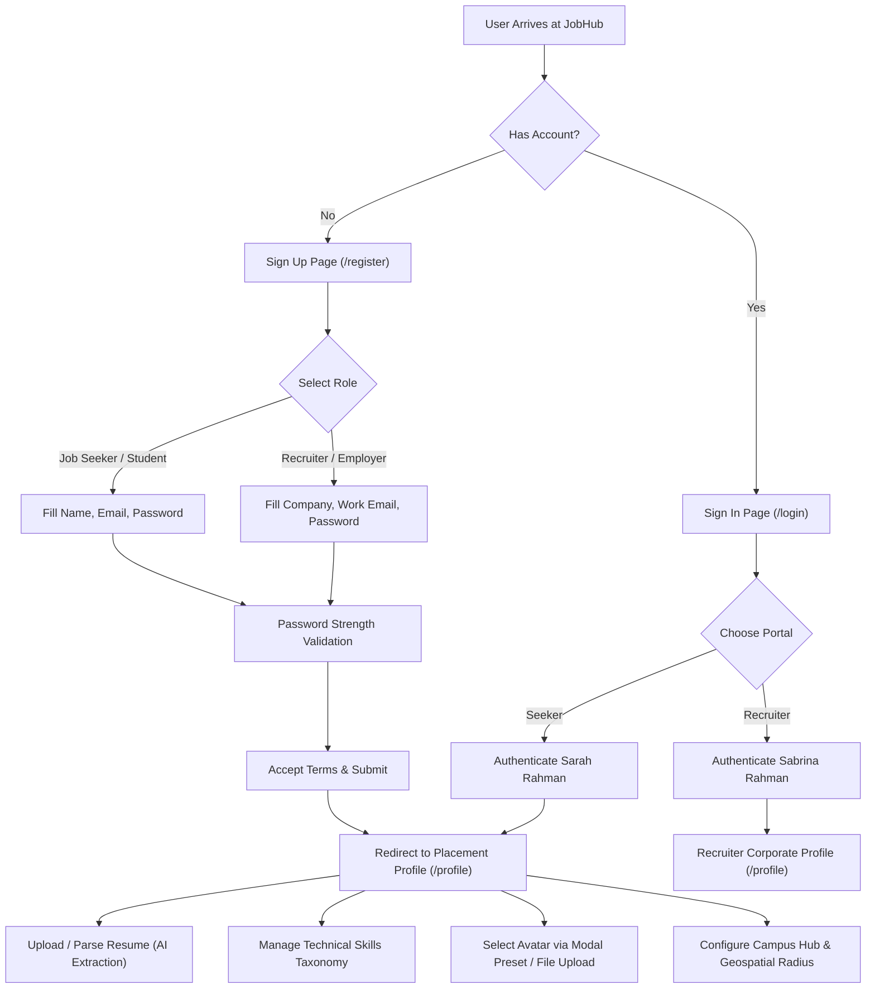
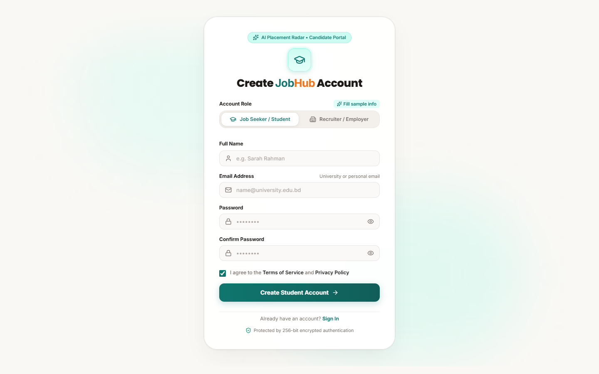
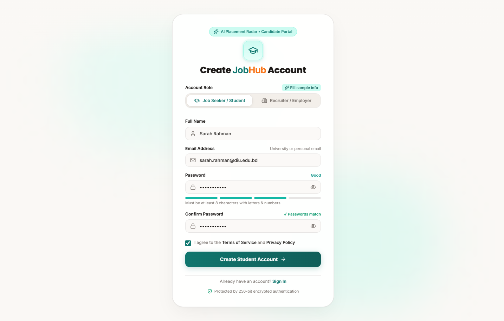
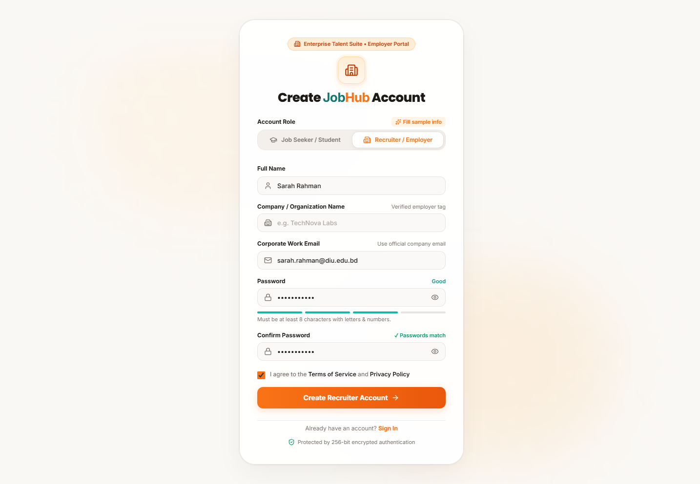
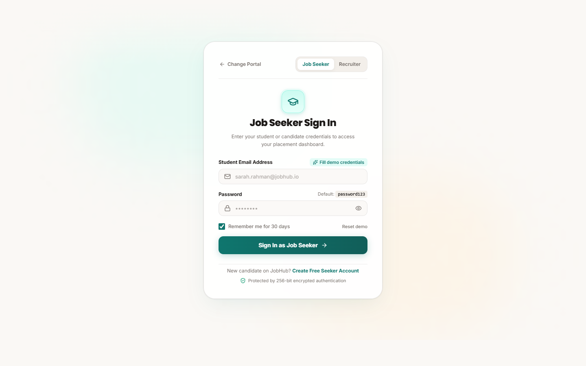
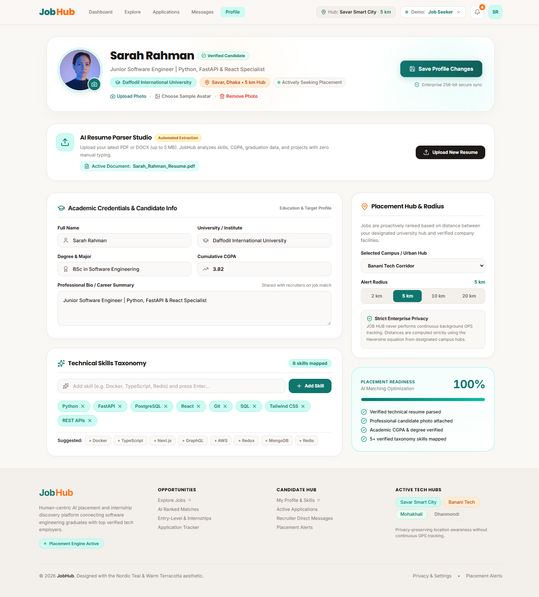
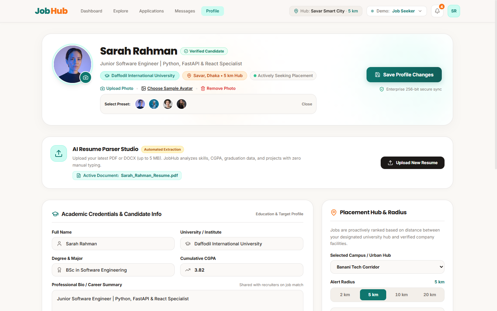
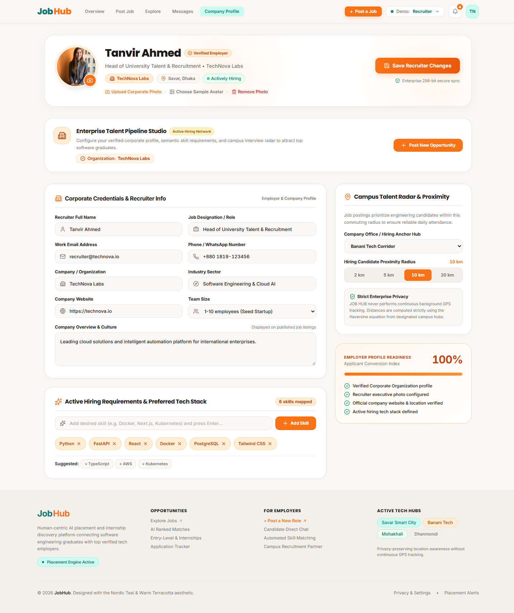
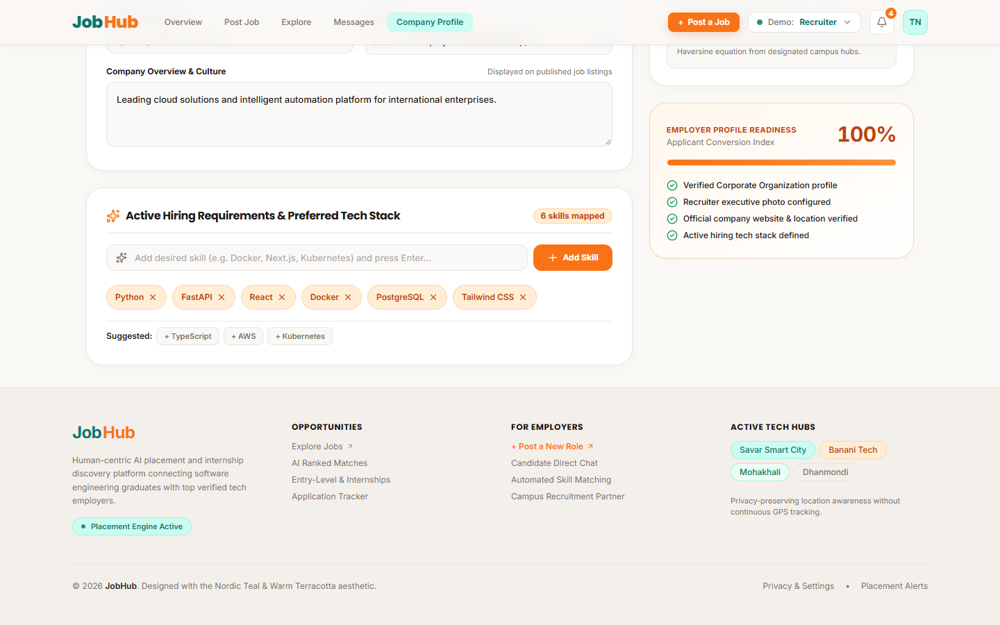

# SE331 — Continuous Assessment 1 (CA1)
## Individual Prototype & UI/UX Design Submission

---

### 📋 Student & Project Metadata

| Field | Details |
| :--- | :--- |
| **Student Name** | **Nadim** |
| **Student ID** | `[Insert Your Student ID, e.g. 211-35-XXXX]` |
| **Course Code & Title** | **SE331 – Software Engineering / System Design** |
| **Assessment Title** | **Continuous Assessment 1 (CA1): Prototype / UI/UX Design** |
| **Project Name** | **JOB HUB** — AI-Powered Smart Placement & Semantic Matching Platform |
| **Assigned Sub-Branch** | [`Nadim`](https://github.com/Saif-AlSaad/JobHub/tree/Nadim) |
| **Live Interactive Prototype** | [https://saif-alsaad.github.io/JobHub/](https://saif-alsaad.github.io/JobHub/) |
| **Local Prototype Host** | `http://localhost:5173` |

---

## 1. Group Discussion & Page Division Summary

During the group discussion phase, our team (*Saif, Nadim, Rizvi*) listed all screens and architectural workflows required for the **JOB HUB** platform. To ensure equal individual distribution and clean separation of concerns, the screens were divided as follows:

| Team Member | Assigned Module & Screens | Core Responsibilities |
| :--- | :--- | :--- |
| **Nadim (Me)** | **User Onboarding, Registration & Profile Ecosystem** • User Registration Page (`/register`) • Profile & Resume Studio Page (`/profile`) • Role Gateway & Authentication (`/login`) | Dual-role sign up (Seeker/Recruiter), dynamic password strength indicator, avatar manager modal, AI resume parser studio, interactive skill tag taxonomy, academic metrics, and geospatial placement radar. |
| **Saif** | **Analytics, System Governance & Role Dashboards** • Job Seeker Dashboard (`/`) • Recruiter Pipeline Hub (`/recruiter`) • System Admin Governance (`/admin`) | Metric scorecards, real-time activity feeds, candidate pipeline Kanban boards, and admin platform management. |
| **Rizvi** | **Job Discovery, Semantic Matching & Application Tracking** • Jobs Search & Filter Radar (`/jobs`) • Job Detail & Match Analysis (`/jobs/:id`) • Applications Tracker (`/applications`) | Job search filtering, match score breakdown card, application timeline tracking, and recruiter applicant review. |

---

## 2. Detailed Breakdown of My Assigned Pages

### 2.1 Screen 1: User Registration Page (`/register`)

#### Purpose & UX Architecture
The Registration screen is the primary gateway for all new users entering the JobHub ecosystem. To accommodate both students/graduates and corporate talent acquisition teams without duplicating routes, a **dual-role switcher** is built directly into the form header.

#### Key UI/UX Features & Interactive Details
1. **Dual Role Switcher**:
   - `Job Seeker / Student`: Configured for university candidates; requests full name and university email.
   - `Recruiter / Employer`: Automatically adapts inputs to request **Company Name** and corporate work email.
2. **Dynamic Password Entropy & Strength Meter**:
   - Analyzes password complexity in real-time across four discrete tiers:
     - **Weak** (Red: `< 6 characters`)
     - **Fair** (Amber: `6-7 characters`)
     - **Good** (Teal: `8+ chars, alphanumeric mix`)
     - **Strong** (Emerald: `10+ chars, uppercase, digits & special symbols`)
   - Visual progress bar dynamically fills and color-codes to give immediate feedback.
3. **Form Integrity & Accessibility**:
   - Show/Hide toggle icons on Password and Confirm Password inputs.
   - Inline matching validation ensuring password confirmation equality.
   - Integrated "Terms of Service" & "Privacy Policy" agreement checkbox.
   - Quick prefill helper (`Fill sample info`) for instantaneous demonstrator testing.

---

### 2.2 Screen 2: User Profile & Credentials Management (`/profile`)

#### Purpose & UX Architecture
The Profile Management screen is the central hub where candidates showcase their academic background, manage verified technical competencies, upload resumes for automated AI parsing, and calibrate geographic placement radii.

#### Key UI/UX Features & Interactive Details
1. **Interactive Avatar Manager & Image Studio**:
   - **Custom Photo Upload**: Features client-side HTML5 Canvas compression (`MAX_DIMENSION: 512px`, JPEG quality `0.85`) to optimize payload size below 100 KB.
   - **Sample Avatar Modal**: An interactive modal offering curated professional headshot presets for instant persona demonstration.
   - **Instant Delete / Reset**: One-click action to revert to default monogram initials.
2. **AI Resume Parser Studio**:
   - Drag-and-drop or file selector for PDF/DOCX documents (up to 5 MB).
   - Visual status pill indicating the active parsed document (`Sarah_Rahman_Resume.pdf`).
   - Automated extraction into academic degree, CGPA, skills, and summary.
3. **Interactive Skills Taxonomy Manager**:
   - Removable skill chip tags with instant `×` deletion.
   - Add new custom skill input with keyboard `Enter` trigger.
   - **Suggested Skill Presets**: Quick-add buttons (`+ TypeScript`, `+ AWS`, `+ Docker`) with live counter of mapped skills.
4. **Academic Credentials & Career Headline**:
   - University/Institute selection, Major/Degree, Cumulative CGPA spinbutton, and candidate bio.
5. **Geospatial Placement Radar**:
   - Preferred Campus/Urban Anchor hub selection (`Banani`, `Savar / DIU Smart City`, `Mohakhali`, `Dhanmondi`, `Uttara`, `Gulshan`).
   - Radial distance threshold selector (`2 km`, `5 km`, `10 km`, `20 km`).
   - Privacy guarantee note: Haversine distance calculations without continuous battery-draining GPS tracking.
6. **Recruiter Organization Profile Mode**:
   - When authenticated as a corporate employer, the page automatically switches to display company profile metrics, industry classification, company size, office address, and hiring tech stack.

---

### 2.3 Screen 3: Dual-Portal Sign In Screen (`/login`)

#### Purpose & UX Architecture
The unified authentication screen providing candidate and recruiter access with quick persona switcher, prefilled credentials for evaluation, and 256-bit session encryption.

---

## 3. UI/UX Design System Specification

| Design Element | Specification & Implementation |
| :--- | :--- |
| **Design Language** | **Nordic Clean & Human-Centric Minimalism** |
| **Background Color** | Warm Canvas Paper (`#FAF8F5`) with subtle radial glow accents |
| **Primary Brand (Seeker)**| Deep Nordic Teal (`#0F766E` / hover `#115E59`) |
| **Accent Brand (Recruiter)**| Vibrant Warm Amber/Orange (`#F97316` / `#EA580C`) |
| **Neutral & Text** | Deep Charcoal (`#1C1917`), Muted Stone (`#78716C`), Border Slate (`#E7E5E4`) |
| **Feedback Accents** | Emerald (`#059669`) for Success/Strong, Amber (`#D97706`) for Warning, Red (`#DC2626`) for Danger |
| **Typography** | Modern System Sans-Serif (`Inter`, `-apple-system`, `Segoe UI`, `sans-serif`) |
| **Micro-Interactions** | Tactile active scale compression (`active:scale-95`), smooth CSS transitions (`duration-200`) |
| **Accessibility (a11y)**| Exceeds WCAG 2.1 AA color contrast standards; visible outline rings on keyboard focus (`focus:ring-4`) |

---

## 4. User Flow & Screen Navigation

---

## 5. Prototype Visual Gallery & Screen Evidence

### Figure 1: User Registration Page — Job Seeker / Student View
*Displays the student registration form, dual-role selector tabs, and clean form layout.*

---

### Figure 2: User Registration Page — Dynamic Password Strength Meter
*Demonstrates interactive form validation with real-time password entropy scoring (Good/Strong tier) and prefilled demo data.*

---

### Figure 3: User Registration Page — Recruiter / Employer View
*Shows dynamic input adaptation: 'Full Name' switches to 'Company Name' and email placeholder adjusts to corporate work email.*

---

### Figure 4: Sign In Authentication Gateway
*Role-based candidate and employer login portal with quick prefill assistance.*

---

### Figure 5: Complete Candidate Profile Management Screen (`/profile`)
*Full view of the Job Seeker profile featuring AI Resume Studio, Academic Credentials (DIU, BSc SWE, CGPA 3.82), Skills Taxonomy, and Geospatial Placement Radar.*

---

### Figure 6: Interactive Avatar Chooser Modal
*Demonstrates the modal dialog offering preset professional avatars with client-side image compression and photo preview.*

---

### Figure 7: Recruiter Corporate Profile Screen (`/profile`)
*Recruiter organization view featuring company size, industry classification, corporate website, Banani office anchor, and hiring tech stack.*

---

### Figure 8: Interactive Skills Taxonomy Management
*Shows dynamic chip additions (`+ TypeScript`, `+ AWS`), tag removal buttons, and live taxonomy count indicator.*

---

## 6. Verification & Prototype Access Link

The interactive prototype is fully operational and can be reviewed via either of the following methods:

1. **Live Cloud Prototype (GitHub Pages)**:  
   🔗 [https://saif-alsaad.github.io/JobHub/](https://saif-alsaad.github.io/JobHub/)  
   *(No setup or dependencies required. Direct access via web browser).*

2. **Official Repository Sub-Branch**:  
   🔗 [https://github.com/Saif-AlSaad/JobHub/tree/Nadim](https://github.com/Saif-AlSaad/JobHub/tree/Nadim)

3. **Evaluation Test Credentials**:
   - **Job Seeker**: `sarah.rahman@jobhub.io` / `password123`
   - **Recruiter**: `recruiter@technova.io` / `password123`
   - **Admin**: `admin@jobhub.io` / `password123`

